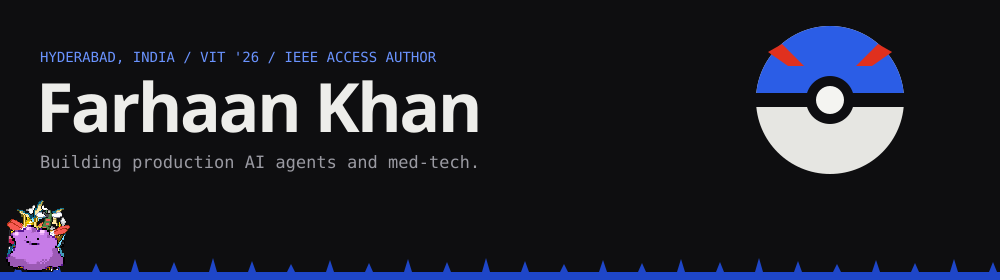
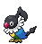
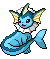
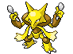
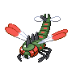
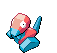
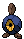
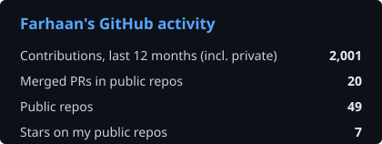
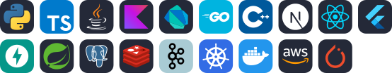

Software engineer at Azntai, building Reznt: an AI agent paying businesses run on WhatsApp, Instagram and phone. I also ship med-tech at Alfaleus. B.Tech CSE from VIT Vellore, CGPA 9.04.

## Wild encounter

These six change every few hours. Pick one and it will be waiting for you on my portfolio, then click it there to throw a ball.

<!-- safari:start -->
<table><tr>
<td align="center" width="16%"> <a href="https://fakubwoy.github.io/portfolio/?wild=320">Wailmer</a></td>
<td align="center" width="16%"> <a href="https://fakubwoy.github.io/portfolio/?wild=158">Totodile</a></td>
<td align="center" width="16%"> <a href="https://fakubwoy.github.io/portfolio/?wild=334">Altaria</a></td>
<td align="center" width="16%"> <a href="https://fakubwoy.github.io/portfolio/?wild=602">Tynamo</a></td>
<td align="center" width="16%"> <a href="https://fakubwoy.github.io/portfolio/?wild=609">Chandelure</a></td>
<td align="center" width="16%"> <a href="https://fakubwoy.github.io/portfolio/?wild=218&shiny=1">Slugma (shiny)</a></td>
</tr></table>
<!-- safari:end -->

## Party

<table>
<tr>
<td width="50%" valign="top">

**[Reznt](https://reznt.com)** 
Next.js / TypeScript / PostgreSQL

Multi-tenant AI revenue agent that sells, takes orders and recovers missed calls across WhatsApp, Instagram, Facebook and phone. Top contributor: 355 of 738 commits, 142 merged PRs. *Private repo.*
</td>
<td width="50%" valign="top">

**[Droptor](https://droptor.in)** 
Flutter / BLE

**1st prize, Glaucoma Society of India Hackathon 2026.** BLE smart-cap eye-drop adherence system with an offline-first patient app and a live doctor dashboard. On the Play Store and App Store. *Private repo.*
</td>
</tr>
<tr>
<td valign="top">

**[agent-eval-harness](https://github.com/fakubwoy/agent-eval-harness)** 
TypeScript / Vitest

Runs 42 scripted support conversations against a fake shop backend and scores tool-calling agents on task success, policy, handoff, latency and cost. CI replays recorded calls with no API keys.
</td>
<td valign="top">

**[ledger-platform](https://github.com/fakubwoy/ledger-platform)** 
Java / Spring Boot / Kafka / Kubernetes

Double-entry [payments ledger](https://github.com/fakubwoy/ledger-service) with idempotent APIs and a transactional outbox, on a Kubernetes platform with Argo CD GitOps, full observability and scripted failure drills.
</td>
</tr>
<tr>
<td valign="top">

**VisioVR** 
Kotlin / OpenGL ES

**2nd prize, same hackathon, built solo.** Simulates 12 eye conditions on the live camera in a phone VR headset, with custom shaders at 60 to 120 fps. *Private repo.*
</td>
<td valign="top">

**[Quantum Deepfake Detection](https://github.com/fakubwoy/QuantDeepfakeDetection)** 
PyTorch / Qiskit

Spotting the impostors. Research code for my [IEEE Access paper](https://doi.org/10.1109/ACCESS.2026.3659021): QAOA feature selection plus quantum-inspired attention, +2.5 points accuracy over classical baselines on FaceForensics++ and 45% lower calibration error.
</td>
</tr>
</table>

<b>In the PC box</b>

 

 **[Visor](https://github.com/sidhant-sriv/visor)**: VS Code extension that draws live flowcharts as you move through code. 1.4k+ installs, 10 merged PRs.

 **[rock-vs-docker](https://github.com/fakubwoy/rock-vs-docker)**: the same Flask API packaged three ways and scanned with Trivy. 1.12 GB and 3,609 CVEs with a basic Dockerfile, 80 in a chiselled rock with zero from OS packages.

## Trainer card

**Badges earned**

**Moves**

